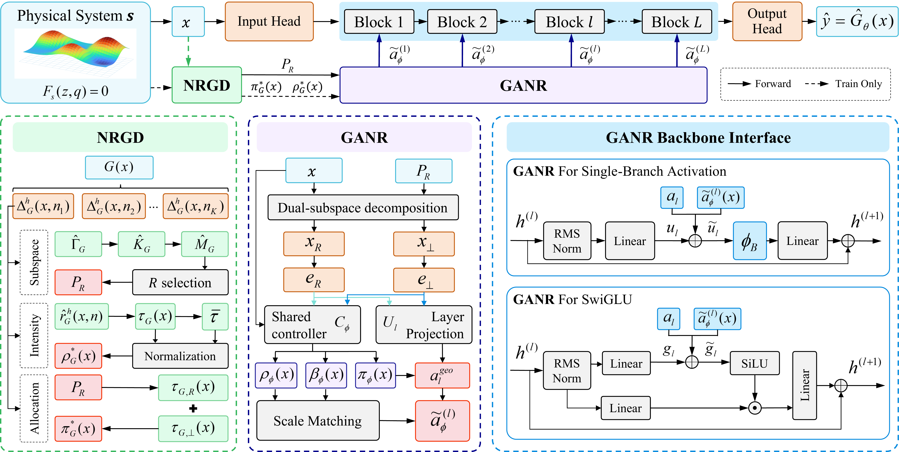
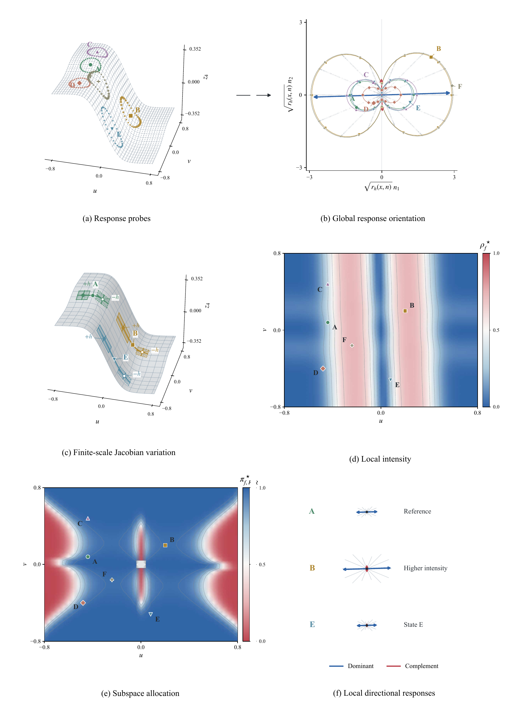
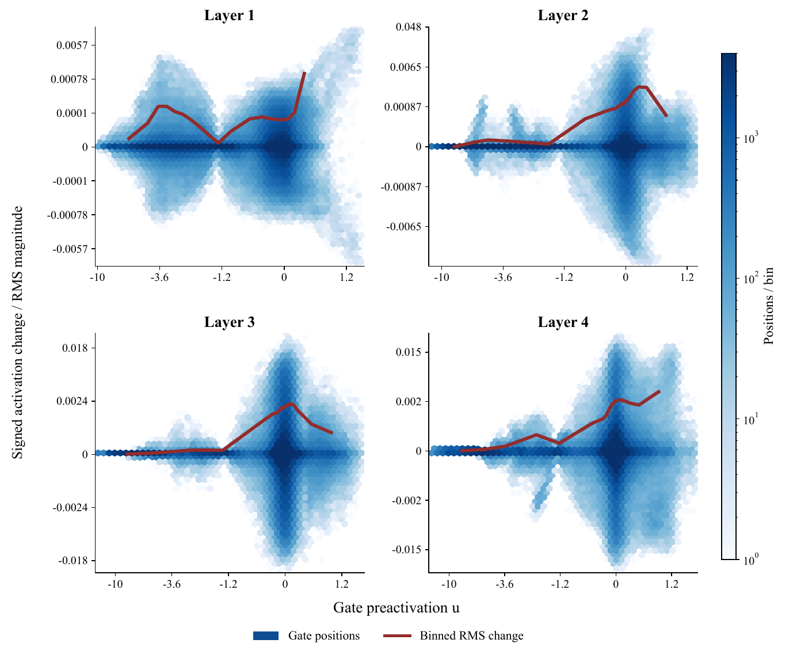

# GA-NAR

**Geometry-Adaptive Nonlinearity Allocation and Representation for Complex Physical Systems**

GA-NAR learns surrogates for solution maps defined by implicit physical equations.
It combines Nonlinear Response Geometry Decomposition (NRGD), which measures
finite-scale variation of the physical solution Jacobian, with Geometry-Adaptive
Nonlinear Representation (GANR), which conditions a residual network on that
geometry. This repository provides the method implementation, benchmark data,
experiment protocols, numerical records, and verification tools accompanying
the manuscript.

## Method and figures

NRGD constructs a global Dominant Nonlinear-Response Subspace (DRS) projector
from training-only directional response measurements. It also estimates two
operating-point descriptors: bounded local response intensity and the allocation
of response between the DRS and its orthogonal complement. The projector acts on
standardized inputs; both subspaces remain available to the model.

GANR encodes the two projected inputs separately. A shared controller predicts
intensity, two-way subspace allocation, and a softmax allocation across network
depth. At each residual block, separate fixed-highway plus trainable low-rank
projections map the branch codes into gate coordinates. The resulting direction
is RMS-matched to the block's unshifted gate and added before its activation.
The intensity and subspace allocation are supervised by NRGD descriptors;
depth allocation is learned from prediction loss. SwiGLU modifies only its gate
branch. Setting the adapter scale to zero exactly recovers the same backbone.

### Figure 1: GA-NAR architecture

<p align="center"><a href="ganar_reproducibility/assets/figures/figure_1_architecture.png"></a></p>

*Figure 1. NRGD constructs the global DRS projector and local response
descriptors. GANR maps their dominant and complementary channels into
layer-specific preactivations. Physical Jacobian measurements provide training
targets; the trained predictor runs without the physical solver.*

### NRGD: from physical response to descriptors

For standardized input $x$ and state $y=G_s(x)$, the physical solution map is
defined locally by an implicit equation. NRGD measures finite-scale variation
of its Jacobian rather than the size of its first derivative:

```math
\mathcal F_s(z,q)=0,\qquad
J_{G_s}(x)=-\bar F_{s,y}^{-1}\bar F_{s,x},\qquad
\Delta_{G_s}^{h}(x,n)=\frac{J_{G_s}(x+hn)-J_{G_s}(x-hn)}{2h}.
```

With frozen unit directions $s_{ij}$ and Hutchinson probes $v_k$, the
response-weighted moment determines a positive-semidefinite, unit-trace
operator and its global DRS projector:

```math
\begin{aligned}
\widehat r_G^h(x,n)&=\frac1{K_H}\sum_{k=1}^{K_H}\|\Delta_G^h(x,n)v_k\|_2^2,\\
\widehat S_G&=\frac1{N_GK_S}\sum_{i=1}^{N_G}\sum_{j=1}^{K_S}
  \widehat r_G^{h_\pi^\star}(x_i,s_{ij})s_{ij}s_{ij}^{\top},\\
\widehat M_G&=\Pi_{\Delta_+}\!\left(
  \frac{(d+2)\widehat S_G/\operatorname{tr}(\widehat S_G)-I_d}{2}
  \right),\qquad P_R=U_{1:R}U_{1:R}^{\top}.
\end{aligned}
```

The rank $R$ is the smallest rank retaining at least 90% of the projected
spectral mass. At each operating point, NRGD separately estimates relative
response intensity and its allocation between the DRS and its complement:

```math
\rho_G^\star(x)=\frac{\tau_G(x)}{\tau_G(x)+\bar\tau},\qquad
\boldsymbol\pi_G^\star(x)=
\frac{(\tau_{G,R}(x),\tau_{G,\perp}(x))}
{\tau_{G,R}(x)+\tau_{G,\perp}(x)}.
```

The intensity and allocation scales $h_\rho^\star$ and $h_\pi^\star$ can be
selected independently. Here $\tau_G$ is the dimension-corrected local total
response, $\bar\tau$ is its mean over training geometry centers, and
$\tau_{G,R}$ and $\tau_{G,\perp}$ are the corresponding subspace totals.
All geometry centers and probe directions are drawn from the training protocol.

<p align="center"><a href="ganar_reproducibility/assets/figures/figure_8_synthetic_response.png"></a></p>

*Figure 8. Synthetic implicit system. On the section $q_4=0$, the state
coordinate $z_4$ varies through coupled parameters. The panels connect
finite-scale Jacobian responses to global orientation, local intensity, and
dominant/complement allocation. The state surface and response descriptors
show different properties of the same solution map.*

### GANR: geometry-conditioned nonlinear computation

GANR retains both projected inputs, $x_R=P_Rx$ and
$x_\perp=(I_d-P_R)x$. Their encoders produce $e_R$ and $e_\perp$. At block
$\ell$, the controller predicts intensity $\rho_\phi(x)$, branch weights
$\boldsymbol\pi_\phi(x)$, and depth weights $\boldsymbol\beta_\phi(x)$.
The branch projections $\mathcal P_{\ell,b}=H_{\ell,b}+U_{\ell,b}V_{\ell,b}^{\top}$
combine a fixed highway with a trainable low-rank residual:

```math
\begin{aligned}
a_\ell^{\rm geo}(x)&=
\sqrt{\pi_{\phi,R}(x)}\,\mathcal P_{\ell,R}(e_R(x))+
\sqrt{\pi_{\phi,\perp}(x)}\,\mathcal P_{\ell,\perp}(e_\perp(x)),\\
\widetilde a_\phi^{(\ell)}(x)&=
\rho_\phi(x)\sqrt{\beta_{\phi,\ell}(x)}\,
\frac{a_\ell^{\rm geo}(x)}{\operatorname{RMS}(a_\ell^{\rm geo}(x))+\epsilon_A}
\operatorname{RMS}(u_\ell(x)),\\
\widetilde u_\ell&=u_\ell+\alpha_A\widetilde a_\phi^{(\ell)}.
\end{aligned}
```

The activation family stays fixed. For SwiGLU, only the SiLU gate preactivation
is shifted; its value branch $v_{\ell j}$ remains unchanged. Figure 19 shows
the resulting gate-induced output difference:

```math
d_{\ell j}^{\mathrm{SwiGLU}}(x)=
\left[\operatorname{SiLU}(u_{\ell j}+\delta_{\ell j})-
\operatorname{SiLU}(u_{\ell j})\right]v_{\ell j}.
```

<p align="center"><a href="ganar_reproducibility/assets/figures/figure_19_swiglu_activation.png"></a></p>

*Figure 19. IEEE-118 SwiGLU activation-output changes across four residual
blocks. Each blue hexagon aggregates validation-sample by gate-neuron positions
with the indicated signed change; darker blue means more positions. The red
curve is the root-mean-square magnitude of those changes within bins of the
unshifted gate preactivation. Nonzero responses across blocks show that the
modulation reaches the nonlinear site; the plot alone does not measure test
accuracy.*

The training objective combines prediction MSE with NRGD supervision of
intensity and two-way allocation. Depth allocation has no physical target:

```math
\mathcal L=\mathcal L_{\rm pred}
+\lambda_\rho\,\mathbb E[(\rho_\phi-\rho_G^\star)^2]
+\lambda_\pi\,\mathbb E[H^2(\boldsymbol\pi_\phi,\boldsymbol\pi_G^\star)].
```

Here $H^2(p,q)=\frac12\sum_i(\sqrt{p_i}-\sqrt{q_i})^2$ is squared Hellinger
distance. The two expectations over geometry targets use training-only centers.

The implementation is in
[`ga_nar.model`](ganar_reproducibility/src/ga_nar/model.py); the data,
training, and command-line interfaces are in the same package and
[`experiments/run_ga_nar.py`](ganar_reproducibility/experiments/run_ga_nar.py).
For a new physical system, [`build_response_geometry`](ganar_reproducibility/src/ga_nar/geometry.py)
accepts training-only standardized operating points and a callable returning
the physical solution Jacobian applied to a vector. It estimates the
finite-scale response, DRS projector, intensity, and two-way allocation. The
caller supplies a Jacobian action valid on the selected regular solution branch.
The trained model's inference path does not call the physical solver or
Jacobian action.

## Install

Python 3.10 or newer is required. From the repository root:

```bash
cd ganar_reproducibility
python -m pip install -e .
```

The packaged benchmark data contain fixed train, validation, and held-out test
splits, together with geometry descriptors for IEEE-118 AC power flow,
Kuramoto-64, and nonlinear heat FEM. Their checksums are recorded with each
trained checkpoint. Use the same standardized input coordinates when supplying
a custom projector or descriptor set.

## Train and evaluate

The following example trains the full layer-wise method on one system and
activation. Output files are written to an ignored local directory.

```bash
python experiments/run_ga_nar.py train \
  --system ieee118_acpf --activation relu --seed 0 \
  --epochs 400 --device cpu \
  --output local_training_results/ga_nar/ieee118_relu

python experiments/run_ga_nar.py evaluate \
  --checkpoint local_training_results/ga_nar/ieee118_relu/model.pt
```

The `train` command fits the prediction loss and NRGD intensity/allocation
losses on training data, selects an epoch by validation MSE, then reports the
held-out standardized MSE. `evaluate` recomputes that metric and rejects
changed source data or geometry. To predict physical states from a NumPy array
of unstandardized physical inputs with shape `(samples, input_dim)`:

```bash
python experiments/run_ga_nar.py predict \
  --checkpoint local_training_results/ga_nar/ieee118_relu/model.pt \
  --input inputs.npy --output predictions.npy
```

The checkpoint stores training normalization and the frozen projector, so the
prediction command does not require a physical solver or geometry target files.
Reproducing the full manuscript tables requires the registered experiment
protocols and substantially more computation than this single-run example.

## Repository layout

```text
ganar_reproducibility/
  src/ga_nar/       layer-wise method, data contract, training
  src/             NRGD, auxiliary studies, and benchmark implementations
  experiments/     method and registered experiment entry points
  configs/         experiment settings
  data_store/      fixed benchmark and geometry artifacts
  results/         archived numerical records
  verification/    package and result-record checks
```

The archived experiment records preserve their original model and result
identifiers for traceability. The `ga_nar` package and command above are the
public entry point for the manuscript's complete layer-wise adapter. Archived
records should not be interpreted as output from a fresh run of that entry
point. Large trained weights are available separately in the
[repository releases](https://github.com/Z-JangCC/GA-NAR/releases).

## Verification

```bash
PYTHONDONTWRITEBYTECODE=1 PYTHONPATH=src pytest -q tests/test_ga_nar.py
PYTHONDONTWRITEBYTECODE=1 python verification/verify_clean_package.py
PYTHONDONTWRITEBYTECODE=1 python verification/audit_result_records.py
```

The verification scripts check method behavior, distributed-file checksums,
and numerical-record consistency. Full benchmark retraining is separate from
these checks.

## Citation

```bibtex
@misc{ganar,
  title = {GA-NAR: Geometry-Adaptive Nonlinearity Allocation and Representation for Complex Physical Systems},
  note  = {Manuscript and accompanying code}
}
```

Please include the system, command, software environment, and relevant output
when reporting a reproducibility issue.
